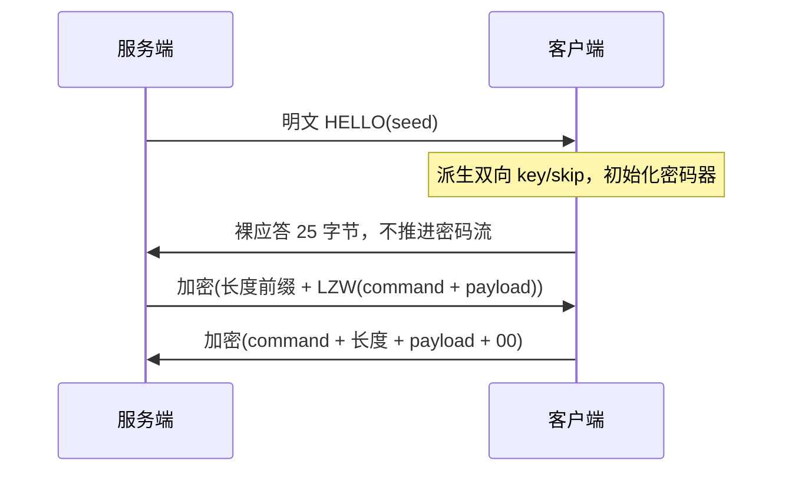

# 原生游戏 TCP：握手、密码器与帧研究（2026-10-20）

## 1. 结论与证据等级

当前交付 [native_channel 0.1.0](../tools/native_channel/README.md) 是独立候选
兼容层。最关键的突破是同一安装包 `exe/render.dll` 存在未保护的 C_net 密码器；
主程序受保护 init/process 尚无法完整离线运行，但两者密钥派生、块生成及调用
布局已交叉核对。**不能把同族 DLL 验证替代目标客户端联网验收。**

| 部分 | 证据 | 当前结论 |
|---|---|---|
| HELLO 字段、SetSeed 顺序、裸应答 | 原始 script.fls code object + mxmain 包装函数 | 已静态确认；高位种子需有符号转换 |
| 四个派生参数 | 两 DLL 原生指令模拟，5 个假种子 | 两者一致，Python 实现一致 |
| 4096 字节生成块 | mxmain 与 render 原生函数，4 个初始状态 | 两者一致，Python 实现一致 |
| init/refill/异或/skip | render 原生函数，双向 9000 字节及分片调用 | Python 与同族实现一致；目标保护包装层待证 |
| 上下行帧 | mxmain 静态反汇编、脚本 SetMaxLenBytes | 非对称格式已确认；整条 socket 链未动态验收 |
| LZW 解压 | mxmain 原生函数对照，跨包/特殊码/字典填满及重置 | Python 与目标函数在固定测试序列中一致 |
| 完整登录/进图 | 无真实 Windows 客户端连接 | 未验收，业务层未接入 |

所有 VA 均为 PE 首选基址 `0x400000` 下地址；实际加载发生重定位时不能直接
拿这些 VA 作进程地址。记录基线：`50f1caa64fd983b736144c4405b18dee440d27ad`。

## 2. 输入锁定与来源地图

| 样本 | SHA256 |
|---|---|
| `mxmain.dll`（`mx.exe` 同摘要） | `637331b54f7fa9fa6c236fa7f9ac8a8b27f228bd46d05046fdccddf52fbe424d` |
| `exe/render.dll` | `7c1563df5e86c7950d2a21d5240c94c79586e287b7fc3ebff877197ae747365f` |
| `data/script.fls` | `8b6e9266bbe91fa77763df7bb2890d55c968c558b8d4b5e415f27febaf6c0d72` |
| `tools/decompiler/script_fls_keys.json` | `43bb090d09b95e234292829e7d5ce1495d53c0ec2ee4e9727d09aac3d97daceb` |

原件只读。汇编原文与复现命令见
[反汇编证据](../tools/native_channel/evidence/native-disassembly.txt)，
脚本操作数见 [code object 证据](../tools/native_channel/evidence/script-bytecode.txt)。
取证脚本仅解析恢复后的 code object，**没有执行恢复游戏模块**。

| 主程序地址/条目 | 用途 | 同族对应 |
|---|---|---|
| entry 4082 `script/login/netlogin.py::S2CHello` | UnpackInt(4/2/1)、SetSeed、NakedSend | 不依赖反编译文本 |
| entry 3176 `script/net.py::CNet.__init__` offset 54..63 | SetMaxLenBytes(3) | 原生构造默认 2 被脚本覆盖 |
| `0x4685b0`，格式串 `0x6b4a9c = "i"` | UnpackInt 以有符号 int 返回 | 影响高位 seed 应答 |
| `0x468250 → 0x4ab360` | SetSeed、RX/TX 初始化与 skip | `0x8ae1e0 → 0x818a70` |
| `0x4abb20` | 派生 | `0x817360` |
| `0x4c54f0 / 0x4c5590` | 受保护 init/process | `0x92c380 / 0x92c3b0` 明文 |
| `0x4c5d00` | 明文密钥流块生成 | `0x92c610` |
| `0x4680a0 → 0x6105c0` | NakedSend 直接 socket 路径 | 不推进密码器 |
| `0x4ab3f0 / 0x4ab460` | 加密发送/解密读取 | — |
| `0x4ab540` | 下行前缀读取、解压、command 分离 | — |
| `0x4aadb0 / 0x4aae50` | 上行构造/终结 | `0x467da3` 等按 payload 字节数累计长度 |
| `0x4c5d50 / 0x4c5e40` | LZW 初始化/解压 | 用主程序原生 oracle |
| `0x4c6060 / 0x4c60e0 / 0x4c6150` | 读码/展开/字典重置 | — |

## 3. 握手与状态切换

直接 TCP 链路由服务端先发明文：

```text
08 01 SS SS SS SS NN NN CC
│  │  └ uint32LE seed  └ certificate:u8
│  └ command=1          NN=server_number:uint16LE
└ 后续 body 长度=8（不含这个前缀）
```

脚本先 `SetSeed(seed)` 初始化两个方向，再 `NakedSend(reply)`。
虽然此时加密标志已开启，NakedSend 包装器直接调用 socket 发送，所以
该应答不加密、不加长度或命令头，也不消耗密码流。

关键的有符号语义：UnpackInt(4) 的返回格式是 `"i"`。
API 接收线上的 uint32 `u`，令 `s = u if u<2^31 else u-2^32`：

```text
r = (((2^32 + s) % 3227993) + 2562088) XOR 6636321
reply = LE32(r)[0:3] + 22 个零字节        # 总计 25 字节
```

不能对所有种子直接使用 `2^32 + u`，高位为 1 的情况会错；也不能对低位
种子直接省掉 `2^32`。SetSeed 使用的仍是原始 32 位位型。
证据：entry 4082 offset 107..131、135..205；UnpackInt `0x46861f..0x468627`。



每次连接重新初始化；分片与包界不能重置密码流。模块处理 HELLO 与第一段
密文粘包时，只把 HELLO 后的字节交给新密码器。

## 4. 密钥派生

`mix(x,p,q) = (((x OR 0x80000000) % p) << 16) OR ((x OR 0x80000000) % q)`。
令 a=b=seed，连续做 **5 轮**：

```text
a = mix(a, 0x6ffd, 0x53ef)
b = mix(b, 0x7159, 0x6ffd)
a = mix(a, 0x758b, 0x7159)
b = mix(b, 0x53ef, 0x758b)
t = (a >> 1) + (b >> 1)       # 在全部 5 轮后计算
c = t % 0xffd
d = t % 0xffb
```

客户端 RX=(a,c)，TX=(b,d)；服务端反向使用。key 与 skip 都参与换块，skip
不仅是首次跳过长度。主程序布局：RX context `+0xf8`，其参数 `+0x1100/+0x1104`；
TX context `+0x1108`，参数 `+0x2110/+0x2114`。

假 seed `0x12345678` 的原生结果：
`a=262823078, b=910890911, c=2654, d=3044`。
由于每轮把最高位置 1，仅相差最高位的初始 seed 会产生相同派生结果；这不意味着
HELLO 裸应答也相同。

## 5. 密码器

结构相对偏移：state `+0`，cursor `+4`，4096 字节缓冲 `+8`，
key 参数 `+0x1008`，skip 参数 `+0x100c`。

1. 初始化 `state=key XOR 0x05027919`，`cursor=4096`，再丢弃 skip 个流字节。
2. 缓冲耗尽时，若 key 和 skip 都非零：
   `x=(mix(state,0x758b,0x7159)+key) mod 2^32`；
   `x=(mix(x,0x6ffd,0x53ef)+skip) mod 2^32`。
   任一参数为零则直接 x=state。
3. 生成 1024 个 word。每 word 做 32 次：
   `x=((x<<1) mod 2^32) OR parity(x AND 0xda3a2a9c)`，parity 为奇数位数时取 1。
   将每次完成 32 步的 x 按 LE32 写入缓冲。
4. 保存最终 x 为 state，若为零则替换为 `0x05027919`；cursor=0。
   此零状态替换发生在生成块以后，不回写已生成的块。
5. 顺序 XOR 输入字节；空指针调用只推进 cursor。加解密相同。

这是确定性的遗留流密码，无 MAC/认证标签。实现用于协议兼容，不是新协议
密码学方案。目标主程序的生成器直接可执行；init/process 被保护层覆盖，
同族实现之外的差异仍是待验边界。

## 6. 帧与压缩

### 下行 S2C

- body 长度 <255：1 字节长度；否则 `ff + LE24(length)`。
- 原生 CNet 默认扩展宽度 2，但当前游戏脚本设为 3；API 可显式选 2。
- 开启加密后，**整个长度前缀和 body 都在密码流内**。`0x4ab540` 对长度首字节、
  扩展长度与 body 均调用解密读取 helper `0x4ab460`。
- 先去帧头，再将整个 body 解压；解压结果第 1 字节 command，其余 payload。
  HELLO 未加密时走原样复制分支，不做 LZW。

### 上行 C2S

`command:u8 | (len(payload)+1):u8 | payload | 00`，整体加密。
构造器预留两字节；各 PacketAdd 按写入字节数累计 `+5`，终结时附加 00 并 +1，
最后把 command、累计长度写回前两字节。
原生代码在总长 >250 时弹出提示，本实现保守拒绝（payload 最大 247）。
没有证据支持给 C2S 套用 S2C 的 `ff+LE24` 长帧格式。

### 固定 11 位 LZW 变体

- MSB-first 11 位 code；0..255 为 literal，256 起为字典引用，2047 为 END，
  可写字典项最大 2046。不是 zlib，也不是可变宽度 GIF LZW。
- 每个 frame 重置位缓冲、上一 code；**字典及填满计数跨 frame 保留**。
- 第一 code 可以引用先前帧已建立的字典；后续 `code == next_code` 使用
  `previous + previous[:1]`（KwKwK）。
- 后续每个 code 建立 `previous + current[:1]`，直到字典填满。
- 字典填满后，若 full_count >5000，则清空并 next_code=256、full_count=0；
  否则 full_count++。触发清空的当前 code 不写新字典项。
- 原生输入耗尽会隐式返回 END。兼容层选择严格显式 END，并检查输出限额和
  不合法引用；这是防截断策略差异，不是原生行为的等价声明。
- 发送端采用 literal-only 有效码流，末尾 END 和零位填充；性能和压缩率没有优化。

## 7. 自动化验证与复现

[普通测试](../tools/native_channel/tests/test_channel.py) 使用固定
[向量](../tools/native_channel/evidence/vectors.json)，不是仅以自身编码器测试自身
解码器。独立 [native_oracle.py](../tools/native_channel/tests/native_oracle.py) 不导入
兼容模块，从样本机器指令生成预期结果；纯手工 11 位码序列测试目标解压器。

向量涵盖：seed 0/1/0x12345678/0x80000000/0xffffffff；双向 9000 字节、非对齐
分段调用、4096 边界；四种块初始状态；连续 LZW 字典引用、KwKwK、7000 literal
触发填满/延迟重置。普通测试另覆盖：高位 seed 应答、HELLO 分片/粘包、上下行
不同格式、长帧、两种扩展宽度、非法长度/终止字节、解压限额、EOF 和重连。

复现命令及可调用示例见模块 README。原生 oracle 只是受控算法函数执行；未运行
完整游戏、未访问官方地址、未用真实账号。`/GS` 检查被模拟返回，不影响被测算法；
不可把这个桩推广到完整程序运行或安全检查验收。

## 8. 不确定项与下一步验收

1. **目标受保护包装函数**：使用已有 dyprot 转储模拟 init/constructor 进入
   `0xdeadc0de` 失败路径，无法证明保护运行时初始化完整。已改用 render 明文
   同族函数验证，不将失败实验算通过。需 Windows 下在已初始化的目标程序中
   提取同样假 seed 的 TX/RX 输出，与向量对照。
2. **真实服务端压缩结束策略/参数**：当前 ctor 默认 11 位、延迟 5000；是否某条
   登录/转服路径改参数或省 END，需授权本地抓包/原生运行证据。
3. **其他连接路径**：SetSeed2、代理/重连中转、证书业务不在支持范围；本研究
   针对直接 HELLO → SetSeed 路径，不把早期 HTTP/IMProtocol 结论套入游戏 TCP。
4. **Windows 与应用层**：无 Windows 实机/EXE/真实客户端连接验证。首次原生
   验收应在回环服务与假账号环境下检查 HELLO、25 字节应答、第一包、连续包、
   跨块以及重连；再接业务协议。当前未改账号、数据库、游戏资源或业务模块。
