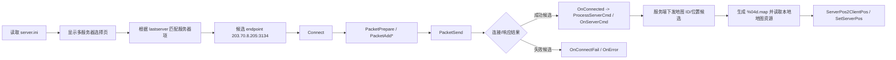

# 梦想世界连接、登录与地图静态分析

## 分析边界

- 分析时间：2026-10-09（Asia/Shanghai）。
- 方式：只读读取本地配置、日志、资源和 PE/DLL 字符串；未启动客户端，未连接外部服务，未做动态抓包。
- 样本根目录：`D:\Lager\夢想世界`
- Case：`work\dream-world-connect-login-map`
- 编码说明：`server.ini`、`service.txt`、`mx.ini` 和游戏日志包含繁体中文文本，按 Big5 解释后可读。以下原文片段用 Markdown 代码块保留；必要时给出字节偏移或日志行号。

## 摘要结论

1. **服务器选择清单**直接来自 `server.ini`。文件列出 6 个显示名/IP/端口/附加字段组合，实际 IP 为 `203.70.8.204`、`.205`、`.206`、`.207`、`.198`，端口全部为 `3134`；`.205` 出现两次，分别对应“推薦區”和“免費區”下的同一地址。
2. **最近选择的服务器**由 `mx.ini` 的 `[Login] lastserver` 保存；当前值为 `免費區 縮小燈(推薦站)`，与 `server.ini` 的第 4 行显示名组合一致，因此当前配置选择对应 `203.70.8.205:3134`，附加字段为 `3 &`。`mxbak.ini` 与 `mx.ini` 完全同 hash，属于同一份备份/镜像状态。
3. **登录前状态**由日志直接确认：程序完成初始化后打开 `login/mainpage.dlg`，随后打开 `login/multi_selserver5.dlg`。日志没有出现 `OnConnected`、角色进入、地图加载或地图编号等运行结果；最后是 `groupSignal: closegame`。因此本样本只证明停留在登录/选服界面，不能证明已连接成功、认证成功或进入空地图。
4. **协议状态机线索**来自 `mxmain.dll` 的导出/字符串集合：`Connect`、`Disconnect`、`PacketPrepare`、`PacketAddI`、`PacketAddUI`、`PacketAddS`、`PacketAddBinaryS`、`PacketSend`、`GetPacketData`、`ProcessServerCmd`、`OnServerCmd`、`OnSpecialServerCmd`、`OnConnected`、`OnConnectFail`、`OnError`。这支持如下静态状态模型：`选服参数 -> Connect -> PacketPrepare/PacketAdd* -> PacketSend -> OnConnected 或 OnConnectFail/OnError -> ProcessServerCmd/OnServerCmd`。没有动态调用证据，不能把每个字符串当作已执行路径。
5. **地图本地加载线索**很明确：`mxmain.dll` 含格式串 `%04d.map`、`can't open mapfile[%s]`、`ServerPos2ClientPos`、`ServerPixelPos2ClientPos`、`ClientPos2ServerPos`、`ClientPos2ServerPixelPos`、`SetServerPos`、`SetServerPixelPos`。本地 `map\` 目录有 101 个 `.map` 文件，均以 `0.1M` 开头；头部后两个小端整数表现为地图资源宽高，例如 `1004.map = 3200x2400`、`2101.map = 2000x1500`、`new2_1054.map = 10000x6000`。这说明地图编号/变体由服务端状态或脚本选择，再映射到客户端文件名；未找到能把登录服务器直接映射到某一个地图编号的静态配置。
6. `data\map.fls`、`data\minimap.fls`、`data\mapobject.fls` 和 `data\script.fls` 是资源包，不是可直接阅读的文本配置；它们包含压缩/二进制数据，静态可见的文件名和地图编号关联不足。`data\map.fls` 的头为 `30 53 4C 46`（`0SLF`），而单独 `.map` 文件的头为 `30 2e 31 4d`（ASCII `0.1M`）。

## 证据明细

### E-001：服务器清单和端口

- source_type: file
- source_ref: `D:\Lager\夢想世界\server.ini`
- content_hash: `257b28d8366dc513ad087b5f0525910a32a1ad38486552bc8d0de31e6db3f985`
- file_size: 283 bytes
- raw_excerpt:

```text
推薦區
縮小燈(推薦站) 203.70.8.205 3134 3 &
免費區
縮小燈(推薦站) 203.70.8.205 3134 3 &
尋寶機 203.70.8.207 3134 3 &
穿透環 203.70.8.206 3134 3 &
任意門 203.70.8.204 3134 3 &
時光機 203.70.8.198 3134 3 &
===================================================
0 縮小燈(推薦站)
```

- 定位：按 CRLF 行号 1-10；二进制 IP/端口文本在偏移 `0x0e`、`0x42`、`0x5e`、`0x7a`、`0x96`、`0xb2` 附近。
- 推断：
  - 第 1 列为分组/区域标题。
  - 每个服务器记录至少包含 `显示名 IP 端口 数字字段 &`。
  - 端口确定为 TCP/网络连接候选端口 `3134`，但仅凭配置文本不能证明传输层或实际连接时刻。
  - `203.70.8.205` 的重复记录不是两个不同 endpoint，而是两个显示分组条目共享同一 endpoint。
- 不确定性：
  - 数字字段 `3` 和尾部 `&` 的语义未从静态证据单独确定，可能是服务器类别、状态或 UI/协议附加参数。
  - IP 属于历史本地样本配置；本分析未解析或连接该地址。

### E-002：最近服务器选择

- source_type: file
- source_ref: `D:\Lager\夢想世界\mx.ini`
- content_hash: `40fd35900ac0a69598439dde1fc931b9324ba2ecb78bf92db89268eb505b923c`
- raw_excerpt:

```ini
[Game]
style=2
opengl=3v;1;
nlc=1
newchar=1
newx=0
refreshserver=1791508722.249000
lastnewchar=1
[Login]
lastserver=免費區 縮小燈(推薦站)
```

- 交叉证据：`D:\Lager\夢想世界\mxbak.ini` 内容和 hash 与 `mx.ini` 相同。
- 推断：
  - 当前客户端持久化的最近服务器显示名为 `免費區 縮小燈(推薦站)`。
  - 与 E-001 对照后，选择落到 `203.70.8.205:3134`，附加字段 `3 &`。
  - `refreshserver=1791508722.249000` 与日志 `iOffsetTime: 1791508722.21` 相差约 0.039 秒，且均对应 2026-10-09 09:18:42 Asia/Shanghai；更像启动/服务器刷新时间基准，而不是端口字段。
- 不确定性：
  - `lastserver` 是显示名索引还是完整连接对象的缓存，需运行时或代码交叉引用确认；本次只做名称到 `server.ini` 的静态匹配。

### E-003：启动、登录页面和最终状态

- source_type: log
- source_ref: `D:\Lager\夢想世界\log\game\gamelog_2026-10-09 09-18-40.txt`
- content_hash: `29aa25ca747da10f7405af6c6d4433bb654ebcb311ce0e3d91f3003ddc03a733`
- raw_excerpt:

```text
[09:18.40]重要節點:---------------GameStart開始---------------
[09:18.40]服務器style None
[09:18.40]本地style 2
[09:18.40]!!新資源 True 新端 True 新夢想 False
[09:18.42]iOffsetTime: 1791508722.21
[09:18.42]滿足新客戶端的判定條件
[09:18.42]重要節點:---------------GameStart結束---------------
[09:18.42]打開 login/mainpage.dlg
[09:18.53]ReadMem gl.initError=true;split;gl.errorMsg=Can't create gl window
[09:18.55]打開 login/multi_selserver5.dlg
[09:33.14]groupSignal: closegame
[09:33.15]清理共享內存
```

- 定位：文件按 CRLF 计数的第 2-32 行；英文错误位于第 23-29 行。
- 推断：
  - 样本运行流程至少达到登录主页面和多服务器选择页面。
  - OpenGL 初始化失败发生在 `09:18:53`，但随后仍记录了选服页面打开，说明日志不能简单解释为在初始化前退出。
  - 从 `09:18:55` 到 `09:33:14` 没有连接成功、认证成功、角色选择、地图加载或服务器命令的可见日志。
  - `closegame` 是此日志片段的结束状态。
- 不确定性：
  - 缺少网络日志/动态调用，不能区分“未点击选服”“点击后连接失败但未记录”“连接请求尚未发出”。
  - OpenGL 错误可能影响 UI/地图渲染，但本日志不能证明它是连接流程停止的唯一原因。

### E-004：Python/启动辅助日志

- source_type: log
- source_ref: `D:\Lager\夢想世界\log\pylog_2026-10- 9 09-18-37.txt`
- content_hash: `51a1af3973c95a6c3d6b44c980ea723c9f4f8910a038ff28d21b5f25920c2759`
- raw_excerpt:

```text
lpCmdLine=, nCmdShow=10
CreateMainWnd 800, 600
Sound設備取得成功
ModuleInit 完成
... open a file d:\Lager\夢想世界\log/game\gamelog_2026-10-09 09-18-40.txt
版本:(2, 27, 2)
執行主要函數 result = 0
退出主要函數
```

- 推断：启动器/主模块成功创建 800x600 主窗口并完成模块初始化；没有提供服务器连接结果。

### E-005：协议和连接状态静态字符串

- source_type: file/static_strings
- source_ref: `D:\Lager\夢想世界\mxmain.dll`（与根目录 `mx.exe` 同内容）
- content_hash: `637331b54f7fa9fa6c236fa7f9ac8a8b27f228bd46d05046fdccddf52fbe424d`
- 关键偏移和原文：

```text
0x2b3778 PacketAddS
0x2b3798 PacketSend
0x2b3938 CServerCommand
0x2b3a74 ProcessServerCmd
0x2b3a88 Connect
0x2b3a90 Disconnect
0x2b3b24 PacketPrepare
0x2b3b34 PacketAddL
0x2b3b40 PacketAddI
0x2b3b4c Connect
0x2b3bb8 PacketAddI
0x2b3bc4 PacketAddUI
0x2b3bd0 PacketAddS
0x2b3bdc PacketAddBinaryS
0x2b3bf0 PacketSend
0x2b42d4 GetTargetServers
0x2b9f38 OnServerCmd
0x2b9f4c OnSpecialServerCmd
0x2b9f64 OnError
0x2b9f70 OnConnectFail
0x2b9fdc OnConnected
```

- 相关字符串：

```text
0x2b6ea8 %04d.map
0x2b7030 can't open mapfile[%s]
0x2b71fc ServerPos2ClientPos
0x2b7214 ServerPixelPos2ClientPos
0x2b7230 ClientPos2ServerPos
0x2b7244 ClientPos2ServerPixelPos
```

- 推断：
  - 客户端有独立的连接、分包/解包、服务器命令处理和连接回调层。
  - `GetTargetServers` 是服务器列表/目标服务器获取相关接口候选，和 `server.ini` 的清单逻辑相符。
  - `OnConnected`/`OnConnectFail`/`OnError` 是可用于验证连接阶段的状态回调候选。
  - `ProcessServerCmd` 与 `OnServerCmd` 表明服务端命令处理发生在连接后的消息处理阶段。
- 不确定性：
  - 字符串表不等于调用图；没有 IDA 交叉引用或运行时采样，不能确定具体 opcode、字段顺序、长度字段、加密前后边界。
  - `mx.exe` 与 `mxmain.dll` 同 hash，说明当前样本中两者是同一 PE 内容的不同文件名；并不表示加载时一定使用两个模块。

### E-006：IMProtocol.dll 的连接/序列化接口

- source_type: file/static_exports_and_strings
- source_ref: `D:\Lager\夢想世界\IMProtocol.dll`
- content_hash: `bc356c88a6470d761b8976f8c027056b8c0e0f483ca2f59cf5c42542e112c82c`
- 关键原文：

```text
0x247e9 IMP_ConnectNsServer
0x24906 IMP_UnConnectNsServer
0x2162c ConnectNsServer
0x21aa0 ConnectNsServer ip:%s, port:%d
0x21b18 OnNsServerConnected  code:%d
0x21b54 OnNsServerUnConnected  code:%d
0x21c08 NsSocket::Send
0x21c90 NsSocket::OnReceive socket
```

- 推断：
  - `IMProtocol.dll` 还包含一条命名为 `NsServer` 的连接通道，至少有 IP/port 格式化日志和连接/断开回调。
  - 该通道可能服务于 IM/辅助服务，不能直接等同于游戏主连接；`server.ini` 的 `3134` 是否也用于此通道没有静态调用证据。
  - `mxmain.dll` 中的 `LoginAMServer`、`GetAMLoginState`、`SendToAMServer`、`RecvFromAMServer` 是另一组 AM/音频或辅助服务接口候选，进一步说明“服务器连接”可能不是单一 socket。
- 不确定性：没有导入调用点、配置映射或动态网络记录，不能把 `NsServer`、AM server 与游戏主服务器做一对一归属。

### E-007：地图文件格式和资源覆盖

- source_type: file/resource_headers
- source_ref:
  - `D:\Lager\夢想世界\map\*.map`
  - `D:\Lager\夢想世界\data\map.fls`
  - `D:\Lager\夢想世界\data\minimap.fls`
  - `D:\Lager\夢想世界\data\mapobject.fls`
  - `D:\Lager\夢想世界\data\script.fls`
- 观察：
  - `map\` 下共 101 个 `.map` 文件。
  - 每个单独地图文件前 4 字节均为 `30 2e 31 4d`，ASCII 为 `0.1M`。
  - 头部小端整数示例：

```text
map\1004.map       0.1M  3200 x 2400
map\2101.map       0.1M  2000 x 1500
map\2302.map       0.1M  2000 x 1500
map\new2_1054.map  0.1M 10000 x 6000
map\test_2302.map  0.1M  1588 x 1220
```

  - `data\map.fls` 前 4 字节为 `30 53 4c 46`（`0SLF`）；`data\minimap.fls`、`mapobject.fls`、`script.fls` 也以 `0SLF`/`FLS` 类资源头开头。
  - `map.fls` 主要为二进制/压缩资源，直接 strings 未得到可靠的地图文件名表。
- 推断：
  - 地图 ID 以数字文件名为主要本地寻址形式，客户端通过 `%04d.map` 生成基础文件名。
  - `new_`、`new2_`、`test_` 前缀表示同一数字空间下的资源变体/测试资源；不能仅凭文件名推断线上会话使用哪一个变体。
  - 地图渲染和角色/服务器坐标之间存在明确的换算函数，支持“服务器位置 -> 客户端地图坐标”的模型。
- 不确定性：
  - 目前没有服务端下发的 map ID、角色初始坐标或登录成功后的第一条地图命令，因此无法推导“该服务器登录后默认地图”或“空地图”的具体编号。
  - `.map` 头部后续 offset 表的完整字段布局尚未恢复；当前只使用共同头和尺寸字段作为资源存在性/格式证据。

### E-008：相关配置与历史服务页面

- source_type: file
- source_ref: `D:\Lager\夢想世界\update.ini`、`D:\Lager\夢想世界\service.txt`
- `update.ini` 关键原文：

```ini
Version=2.27.2
ServerList=http://mxupdate.lager.com.tw/server.txt
Service=http://mxupdate.lager.com.tw/service.txt
ServerNotice=http://mxconfig.duoyi.com/servernotice.txt
FileInfoURL=https://mxconfig.duoyi.com/filemd5.txt
```

- `service.txt` 关键原文：

```text
#Y客戶公告
...
服務時間：AM10:00~PM5:30
伺服器維護時間：每週四10:00~12:00
```

- 推断：
  - 客户端发行配置存在“远端服务器列表/公告/维护信息”概念，但本次未访问这些 URL。
  - 本地 `server.ini` 是当前离线样本实际可用的服务器候选证据；`update.ini` 只能证明历史/配置上的更新入口，不能证明本次启动刷新过列表。

## 静态状态模型



此图是由静态字符串和本地配置推导的候选调用/数据流，不是动态验证过的实际调用轨迹。

## Evidence -> Finding -> Path

### F-001

- title: 当前样本的服务器选择候选指向 203.70.8.205:3134
- severity: info
- category: reverse_algo
- status: candidate
- evidence_ids: [E-001, E-002]
- location: `server.ini:2-10`, `mx.ini:[Login]`
- impact: 可从本地配置恢复服务器显示名到 endpoint 的静态映射；不能证明 endpoint 在本次分析中可达或实际被连接。
- confidence: high
- repro_steps:
  1. 读取 `server.ini` 的服务器条目。
  2. 读取 `mx.ini` 的 `lastserver`。
  3. 按显示名匹配，得到 `203.70.8.205:3134`。
- remediation: n/a for pure RE

### F-002

- title: 日志只证明进入登录/选服页面，未证明登录成功或进入地图
- severity: info
- category: other
- status: candidate
- evidence_ids: [E-003, E-004]
- location: `log/game/gamelog_2026-10-09 09-18-40.txt:17-32`
- impact: 连接、认证、角色进入和地图初始化的后续状态在本地日志中缺失。
- confidence: high
- repro_steps:
  1. 读取日志中的 `login/mainpage.dlg` 和 `login/multi_selserver5.dlg`。
  2. 检查后续记录，确认结束于 `groupSignal: closegame`。
- remediation: n/a for pure RE

### F-003

- title: 客户端具备连接、包构造、服务端命令和地图加载的静态接口线索
- severity: info
- category: reverse_algo
- status: candidate
- evidence_ids: [E-004, E-005]
- location: `mxmain.dll` string offsets `0x2b3778-0x2b9fdc`
- impact: 可据此继续做离线交叉引用，定位 endpoint 解析、连接参数、消息分发和 map ID 使用点；当前尚未恢复 opcode 或完整字段布局。
- confidence: medium
- repro_steps:
  1. 对 `mxmain.dll` 做只读字符串扫描。
  2. 记录 `Connect`、`PacketPrepare`、`PacketSend`、`OnConnected`、`OnConnectFail`、`%04d.map` 等结果。
- remediation: n/a for pure RE

### P-001

- title: 服务器选择到本地地图资源的候选调用路径
- path_type: callflow
- start: `server.ini` / `mx.ini`
- goal: 客户端根据服务端状态加载本地地图
- steps:
  1. 读取服务器条目并匹配 `lastserver`； evidence: E-001, E-002; finding: F-001
  2. 进入登录主页面和服务器选择页面； evidence: E-003; finding: F-002
  3. 候选连接调用 `Connect`，使用 `PacketPrepare`/`PacketAdd*`/`PacketSend`； evidence: E-004; finding: F-003
  4. 候选结果通过 `OnConnected` 或 `OnConnectFail`/`OnError` 分支处理； evidence: E-004; finding: F-003
  5. 若服务端下发地图 ID，按 `%04d.map` 读取地图并用服务器/客户端坐标换算； evidence: E-004, E-005; finding: F-003
- residual_risks: 没有动态调用、服务器响应、opcode 或地图 ID 样本；以上是静态候选路径。

## 不确定性与后续静态工作

- 目前没有成功登录日志、PCAP、客户端录制文件或服务端响应样本，无法恢复登录 opcode、账号字段、认证结果码、地图下发字段或“空地图”触发条件。
- 若继续保持离线只读范围，优先对 `mxmain.dll` 做导出/字符串交叉引用，目标是定位 `server.ini` 解析函数、`lastserver` 读取函数、`Connect` 参数结构和 `ProcessServerCmd` 的命令分发；再对 `.map` 文件头的 offset 表做字段命名。
- `AudioLog\im(2026-10-9).log` 的内容是短二进制/混淆样式消息，能确认有 IM 日志写入，但没有可可靠解码的服务器、端口或地图字段，未作为协议字段证据使用。
- `log\rdpush.txt` 仅含 `sk(0,30,1..3)`，更像资源/技能脚本残留，未与连接或地图建立证据链。

## 可复现只读命令

以下命令只读取本地文件，不启动客户端、不连接网络：

```powershell
# 查看配置/日志原始字节
Format-Hex -Path 'D:\Lager\夢想世界\server.ini' -Count 512
Get-Content -Raw 'D:\Lager\夢想世界\mx.ini'

# 列出地图资源
rg --files 'D:\Lager\夢想世界\map'

# 读取 PE/DLL 可打印字符串（若本机提供 strings）
strings 'D:\Lager\夢想世界\mxmain.dll' |
  Select-String -Pattern 'Packet|Connect|Server|Map|OnConnected|OnConnectFail'

# 计算证据文件哈希
Get-FileHash 'D:\Lager\夢想世界\server.ini'
Get-FileHash 'D:\Lager\夢想世界\mxmain.dll'
```

